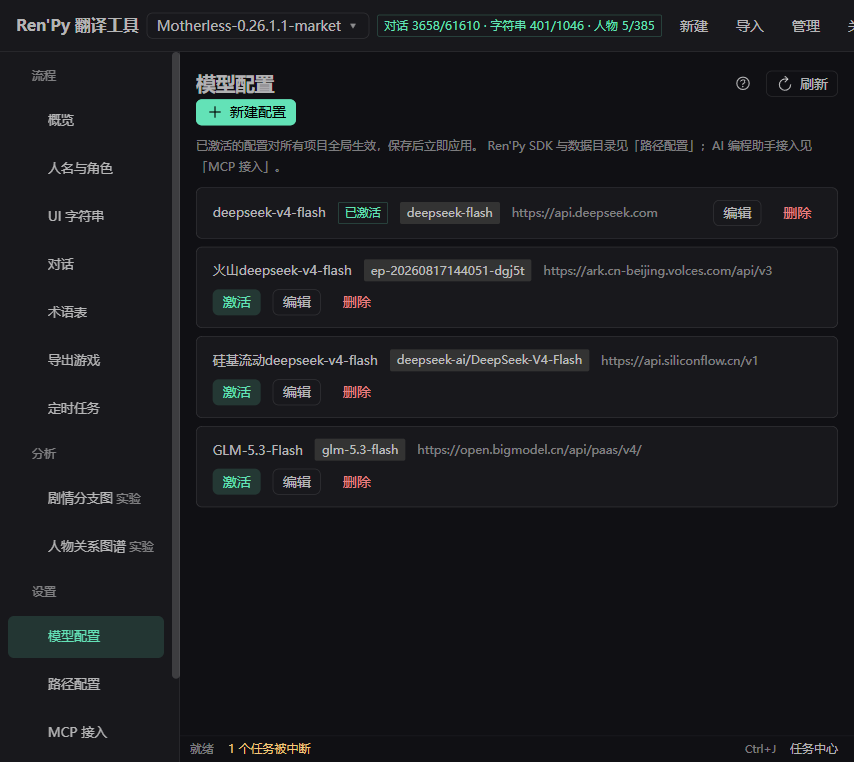

# Ren'Py 翻译工具 · 界面介绍与使用说明

本文按界面逐页介绍工具功能与完整使用流程。截图取自真实项目（深色主题）。

## 界面总览

启动后驻系统托盘（托盘菜单：打开界面 / 用浏览器打开 / 退出服务）。
界面为 Web UI，关窗、关浏览器都**不会中断**正在运行的任务。

整体布局：

- **顶栏**：当前项目下拉框（可快速切换/关闭项目）+ 实时进度统计
  （`对话 9421/69549 · 字符串 3332/3332 · 人物 83/83`）+「检查更新」按钮
  （旁带开关：启动时自动检查，有新版本才弹窗，失败/无更新静默）
- **左侧菜单**：项目管理 / 人名翻译 / 字符串翻译 / 对话翻译 / 术语表 /
  剧情分支图·实验 / 人物关系图谱·实验 / 导出游戏 / 提示词设置 / 模型配置
- **主区域**：各功能页面

每个页面右上角有**帮助按钮**（?），点开即本说明对应章节的详细介绍。

长任务（建项、批量翻译、导出）在后台执行，弹出进度对话框带实时日志；
刷新页面或重开浏览器会自动重连回放进度。任务全程可取消，重复点击同类任务不会并发执行。

---

## 1. 模型配置（首次使用先来这里）



首次使用按顺序完成两项配置：

1. **Ren'Py SDK**：页面列出 tools/ 下**全部已安装的 SDK**（版本、路径、默认标注）。
   导出按游戏引擎**精确版本优先**匹配（游戏 8.3.2 就用 8.3.2），无精确匹配才退回
   同大版本最新。缺 7.x/8.x 大版本会自动下载补齐；也可在「其他版本」输入版本号
   （如 `8.4.1`）下载指定版本。SDK 固定安装在数据目录的 `tools/` 下。
2. **AI 模型**：「新建配置」添加 OpenAI 兼容接口（DeepSeek、GPT、Claude、OpenRouter 等均可），
   填写名称、模型 ID、接口地址与 API Key。进阶参数：
   - **温度**：留空即不发送该参数，跟随模型默认
   - **max_tokens**：**留空=不设上限**（推荐，不发该参数，跟随模型默认上限，避免截断
     输出）；只在需要安全上限时才显式设置
   - **上下文窗口(K)**：单次请求的总预算，1K = 1024 tokens。提示词、术语/人名、参考台词、
     待译内容和输出共用此容量。LM Studio 应按实际加载长度填写，例如 32768 tokens 填 32；
     此处不会改变模型服务的加载设置。
   - **参考台词行数**：单句翻译取前后各 N 行，批量仅取前文、最多 8 行；窗口不足时减少，
     填 0 不附带参考台词。参考台词不作为本批待翻译内容。
   - **每批句数**：一次请求最多翻译的条数，不是并发数。实际批次还受上下文窗口限制；
     长句会自动少分。调大减少请求次数，但单次等待更久，漏译多时可调小。
   - **思考模式**：三态——「跟随模型默认（不发参数）」/「开启」/「关闭」
     （DeepSeek V4 / GLM / 豆包等支持 thinking 参数；DeepSeek V4 默认即思考，
     要关掉须显式选「关闭」；接口不支持时「测试连接」会报 400，改回默认即可；
     思考内容占输出额度——max_tokens 留空时无需额外调整）

另有**数据目录**设置：项目、配置、日志、导出的存放位置。修改后会把现有数据整体迁移过去
（迁移期间请勿操作）。便携版数据在 exe 旁，整目录拷走即完成迁移。

> 调试与排障请用左侧「诊断」页（API 日志与模型调用轨迹），不在本页。

---

## 2. 项目管理


项目卡片显示：项目名、所用模型、翻译进度条与明细（对话/字符串/人物）、
「打开导出目录」「更新报告」快捷入口。每张卡片的操作：

| 按钮 | 说明 |
|---|---|
| 打开 | 设为当前项目（顶栏随之切换） |
| 编辑 | 修改项目名 / 模型等 |
| 更新版本 | 游戏出了新版本后就地升级项目（见下文「版本更新」） |
| 导出 | 导出项目包（备份/迁移用，可在别的机器「导入项目」） |
| 删除 | 删除项目数据（不影响原游戏） |

### 新建项目


点「新建项目」，填项目名称，游戏来源二选一：

- **路径输入**：填游戏目录（含 `game/` 的上一级或游戏根目录）
- **上传 zip**：直接上传游戏压缩包

选择 AI 模型后点「创建」，后台自动完成：**解包 `.rpa` → 反编译 `.rpyc` →
检测引擎版本并匹配 SDK → 生成标准翻译模板 → 解析入库**。
期间若检测到游戏自带中文翻译会弹窗询问处理方式，三个选项：

- **保留官中继续翻译**（推荐）：把官方译文导入为已翻译条目，在此基础上继续翻译，
  没译的照常翻译；非 `chinese` 目录名（如 `schinese`）会自动归一
- **删除官中**：移除自带中文，全部重新翻译
- **取消**：放弃创建

macOS 游戏包（`.app`）自动识别：工程定位、**应用壳随项目保留**，
导出时可选择带壳产出解压即可双击运行的 `.app`。
rpyc-only 游戏缺少 unrpyc 时会提示安装方法。

> 反编译依赖：安装包已内置 unrpyc，开箱即用；便携/开发版需自行放置
> `tools/unrpyc/`（详见 README「反编译依赖」一节）。

---

## 3. 人名翻译（建议最先做）


建项后自动提取全部角色定义（含 DynamicCharacter、玩家可改名占位符）。

- 顶部支持**搜索**（原文人名/变量名/中文名）与**状态筛选**
  （全部/未翻译/已翻译/未分析）；「原文人名」「台词数」列头可点击排序
- 表格列：
  - **变量名**：脚本中的角色变量（如 `m`、`a`）
  - **原文人名 / 中文名**：中文名一列**点击后进入编辑**，Enter 或点别处即存
  - **台词数**：该角色的台词总量（可排序，主角优先精修）
  - **翻译 / 分析**：完成状态标记

操作：

- **全部翻译+分析**（推荐）：一次 AI 调用同时翻译人名 + 生成角色画像
  （性格、说话风格、口癖、称谓、翻译建议等）。人名译文和角色画像都会注入后续所有翻译，
  显著影响质量。分析会**自动抽样台词**（每角色默认最多约 300 句，按口癖/标点/称谓等
  线索加权选句，而非均匀抽），万句级角色也只需 2-3 次调用，成本可控
- 每行**翻译+分析**可单独重跑；画像已好只想换译名时用**重译名**（不动画像）；
  人名已定只补画像时用**仅分析**；不想译名（保持英文原名）用**保留原名**
- 「查看」可看该角色的完整画像

---

## 4. 字符串翻译（菜单、按钮等 UI 文字）


- 顶部：**全部翻译** / **翻译本页** / **重建上下文** / **提取内嵌文本** / **导出** / **导入** / 刷新
- 筛选：全部 / 未翻译 / 已翻译；支持原文/译文搜索、分页；「原文」列头可点击排序
- 表格中**点击译文打开多行编辑窗**，可同时查看原文；Enter 换行，点击保存或 Ctrl/⌘+Enter 保存。
  保存失败保留草稿，取消放弃本次编辑。
- **多选清空译文**：行首勾选框手选（跨页保持），表头勾选=本页全选，「全选筛选结果」=
  全部页；选中后出现操作条，一键清空所选译文（带确认），清空后回到「未翻译」便于重翻
- **查找并替换译文**：在当前筛选范围的所有页中按字面、区分大小写替换译文；
  先预览匹配条数、出现次数及前 30 条前后对照，再确认应用。原文不变。
  预览后相关译文变化会要求重新预览；替换会匹配译文中的变量/标签，请检查预览。
- 每行「AI翻译」单条重翻；「上下文」查看该条在源码中的位置

**提取内嵌文本**：扫描源码中没包 `_()` 的界面/脚本文本（如写死的按钮文字），
AI 预筛 + 人工复核（可查看源码上下文、单句精判、全部重判），确认后原位标记，
再由 SDK 重新生成模板入库翻译。

---

## 5. 对话翻译（主战场）


与字符串页类似，多了**按角色筛选**（配合人名页的台词数，先翻主角线）和**风格指南**入口；
「角色」「原文」列头可点击排序。

建议先设定主要角色译名与风格指南，再批量翻对话。无需所有角色完成翻译和分析；
缺少的角色资料会在任务日志中提示，已有的人名和画像仍然注入提示词。

- **翻译模式**：深度（全效果）/ 轻量（仅术语表+「翻译建议」）/ 纯批量（无附加效果）
  一键切换；「微调」可分别开关术语提取、术语表、风格指南、角色特征（全量/仅翻译建议/
  关闭）与上下文。省钱优先选轻量或纯批量，质量优先选深度
- **风格指南**：可手写，也可让 AI 从台词抽样自动生成；翻译时全程注入，统一语气文风
- **批量翻译**：全部 / 本页两种粒度，随时可停止；中断后重发会**自动跳过已完成部分**
- 翻译时自动注入：术语表、人名表、角色特征、label 上下文、风格指南（受翻译模式控制）
- **上下文**：查看该句所属 label 与前后文，便于判断语气
- 点击译文打开多行编辑窗；**清空**按钮（行内，带确认）一键清掉译文并回到「未翻译」，
  便于重翻；**多选清空**同字符串页（勾选跨页保持 / 表头全选本页 / 全选筛选结果）；
  或使用带预览的查找替换批量统一译名。
- 进度分别显示已处理、成功和待重试条数。取消会等当前批次（包括内部重试）结束，
  保存成功译文后停止后续批次，并跳过任务收尾的自动补跑；失败条目可单独重试。
  请求失败、漏译和校验错误会触发重试，但不能保证发现所有人名误译。

---

## 6. 术语表


翻译过程中 AI 会自动积累术语（地名、怪物名、技能名等），本页集中管理，
翻译时全量注入 prompt，保证前后译名一致。

- **来源**：`AI`（翻译时自动添加）/ `手动`（本页新增），可按来源筛选
- **新增术语**：填原文（必填）、译文、类型（游戏术语 / UI 术语）
- **搜索**：按原文/译文模糊搜索；「原文」「译文」「来源」「创建时间」列头可点击排序
- **译文点击编辑**：发现 AI 译得不准的术语，点击直接改，后续翻译立即生效
- **删除**：带二次确认

---

## 7. 导出与导入翻译文本

对话翻译、字符串翻译、人名翻译、术语表四个页面的工具栏都有**导出**和**导入**按钮；
对话/字符串/人名页另有**从其他项目导入**（见下文）。

**导出**：勾选导出内容（四类可任意组合，预勾选当前页类型）、格式与导出列，
文件保存到 `exports/<项目名>/`，对话框内可直接下载或打开所在目录：

- **Excel (.xlsx)**：每类一个工作表，表头加粗、冻结首行
- **Word (.docx)**：每类一节一张表格
- **翻译 Word (.docx)**：只含原文、每条一行，除此之外什么都没有——
  发给译者翻译后导回（见下方导入）
- **文本 (.txt)**：分节纯文本，Windows 记事本可直接打开
- **JSON (.json)**：结构化数据，可供程序处理或导回

导出的 Excel/Word 统一中文宋体、西文 Times New Roman。
对话/字符串页还可选「仅当前筛选结果」，按当前筛选/角色/搜索条件导出。

**导入**：选择文件后直接写回并提示各类写回条数（未匹配条数一并提示）：

- **JSON**（本工具导出的格式）：按原文匹配，顺序无关；同原文多条全部写回，
  库内没有的术语自动新增
- **翻译 Word**：译者把每行原文替换为译文后导回，按行顺序与库中条目一一对应。
  **导入时选择的内容类型与范围必须与导出时完全一致**，行数不符会报错；
  与原文相同的行视为未翻译跳过。⚠️ 错选类型/范围会导致译文错配，导入前请确认。

**从其他项目导入**（对话/字符串/人名页）：同一系列或重制版游戏常有大段重复文本，
直接复用其他项目已翻译好的译文。流程三步：选源项目与内容类型 → 预览分组 → 确认导入：

- **可直接导入**：当前项目还没译的条目，默认勾选
- **冲突**：双方译文不同——逐条对比（原文 / 当前译文 / 源项目译文）选「用源」或
  「保留当前」，有批量按钮
- **疑似匹配**：原文相似但差距较大的（变量名/标记差异之外的改动），显示相似度，
  **一律人工确认**，默认不导入
- 译文相同的自动跳过。两段式落库：预览后项目数据有变化会要求重新预览

---

## 8. 剧情分支图（实验功能）


> ⚠️ **实验功能未经完整验证，不能确保准确性**：剧情图由脚本静态解析 + AI 摘要生成，
> 复杂游戏的动态跳变（事件袋、程序化导航等）只能靠静态手段恢复，**结果可能与游戏
> 实际剧情不一致**（分支遗漏、场景错配、结局误判等）。本页仅供翻译时参考浏览，
> 请勿作为剧情事实依据。

静态解析游戏脚本，把剧情按场景组织成图谱：每个场景是一张卡片（AI 摘要标题、
场景缩略图、出场角色、翻译进度着色——绿=全译 / 黄=部分 / 灰=未译），卡片间连线
是剧情跳转。

操作：

- **构建剧情图**：静态解析 + AI 逐场景摘要 + 缩略图合成，首次构建较久；
  **重新构建**为全量重建（AI 重新分析），**增量更新**只补新增内容、不重跑 AI
- **逐级展开**：点卡片右侧 `+` 展开后续分支；**搜索**标题/摘要/label 命中时
  自动展开最短路径；**跳转到结局**下拉选中后图自动定位并展开路径
- **按文件过滤**（纯筛选）；**未决边**开关（静态解析无法确定的动态跳变边）
- **换缩略图**：每个场景有多帧候选，卡片上可手动挑选

**引擎渲染（实验）**：页面顶部开关（与人物关系图谱页共用，开一处两处生效）。
默认缩略图由 Pillow 合成（图像文件 + transform 静态近似）；开启后改用游戏自己的
Ren'Py 引擎在沙盒中逐场景回放渲染——真实 ATL 动画、layeredimage 分层立绘、
CG 渲染路径都能与游戏一致。

> ⚠️ **引擎渲染是实验性中的实验性功能，不能保证正常运行**：沙盒要在后台驱动游戏
> 引擎回放，深度定制初始化的游戏可能渲染失败或画面不完整。失败会**明确报错**
> （不静默回退）；关闭开关即回到 Pillow 合成，其余功能不受影响。

---

## 9. 人物关系图谱（实验功能）


> ⚠️ **实验功能未经完整验证，不能确保准确性**：关系由 AI 从台词推断，
> **可能与游戏实际人物关系不一致**（漏判、误判、立场偏差等），仅供参考。

- **AI 生成关系图谱**：AI 通读台词推断角色间关系，按类别图例着色；
  支持**阵营**标签筛选、**共现**边开关
- **AI 重新生成**会替换上次自动结果，**人工添加的关系保留**
- **添加关系**手动补充；点角色头像打开角色卡（立绘、台词数、关系列表），
  立绘头像可从候选中手动更换
- **引擎渲染（实验）**开关与剧情图页共用：开启后立绘由引擎沙盒渲染
  （同样属于实验性中的实验性功能，不能保证正常运行，失败明确报错）

---

## 10. 导出游戏


标题行即操作区：**开始导出** / 刷新 / 打开导出目录。
卡片显示总体进度，以及对话、字符串、人名三项各自的小进度条。

macOS 来源的项目可勾选**带 macOS 应用壳**（默认勾选）：导出包解压后是可双击
运行的 `.app`；不勾选则与 PC 版一致只含游戏工程。

点「开始导出」一键完成：

1. 填充对话/字符串译文
2. 写入角色名 `translate python` 覆盖块
3. 注入中文字体（含 font_replacement_map 覆盖写死字体）
4. 添加语言选择入口
5. 用对应大版本 SDK 做**编译校验**，失败时 AI 自动修复（译文修复/内嵌拆除）
6. 反编译产生的 `.rpy` 自动移除，游戏运行原始 `.rpyc`

成品 zip 在 `exports/<项目名>/<项目名>-translated.zip`，解压即可运行；
页面上「打开导出目录」直达。

---

## 11. 版本更新（游戏出新版后）

在项目管理页点「更新版本」，选择新版游戏目录/zip，就地升级：

- 已有译文按原文**自动继承**
- 微改句子**模糊匹配预填** + 复核表人工确认
- 失效旧译文保留可查
- 更新中途失败/取消会**自动恢复到更新前状态**，不会留下半成品数据

---

## 12. 提示词设置（高级）

这里可以修改工具发给 AI 的**全部提示词**：对话翻译、UI 翻译、人名翻译、
人物分析、内嵌预筛、关系推断、场景摘要、导出修复、重试纠正，共 27 条。
想调整翻译语气、判定标准、输出要求等，改这里即可，无需改程序。

**基本用法**：左侧按分类选一条 → 右侧直接编辑 → 保存。修改立即生效
（下一次 AI 调用起）。

**生效范围**（编辑框右上角切换）：

- **全局（所有项目）**：对全部项目生效
- **本项目**：只对当前项目生效，且优先于全局（不覆盖的条目仍走全局）

**模板语法**（只有两种标签，外加注释）：

- `[[x]]` **纯注入**：把 x 的值原样填进来。值为空就填空——周围文字照常发。
  例：`[[text]]`、`[[lines_text]]`。
- `[[?x]]` **可选段落**：也是注入点，同时标记「本自然段可选」——x 的值为
  空时，整段（空行分隔的文字块，连同段里的标题等固定文字）连同一个相邻
  空行一起消失；有值则整段保留并填入。段内其他 `[[token]]` 不影响段落存废。
- `#` 开头的行是**注释**，只写给人看，发送给 AI 前自动剔除（`##` 开头的
  不是注释，是正文小标题）。

**内容块标题随内容注入**：模板里像 `【作品风格指南】`、`【前文参考】` 这类
给注入内容起名的标题，会随内容一起自动发给 AI——内容为空标题也就不出现。
所以模板里**不要把这些标题写成正文**（会发两遍），用 `#` 注释标给人看即可。
模板正文保留的是固定指令句（如「请根据该角色的身份和性格……翻译。」）。

换行就靠模板里的普通换行，标签不管排版。点击下方占位符按钮可把标签插到
光标处。占位符可以删（对应内容不再注入），但保存时会警告。

> 旧版的 `[[#x]]…[[/x]]` 条件段写法已停用。要「一段文字随内容出现」，
> 把这段文字和 `[[?x]]` 写进同一个自然段即可。

**解析契约锚点**：部分提示词的输出会被程序按固定锚点解析（如
`【人名翻译】`、`submit_translations`）。删除这些锚点会导致解析失败——
保存时会警告，介意就不要动。

**恢复默认**：每条旁边可单独恢复（清掉全局与项目两层自定义）；
页顶「全部恢复默认」一键回到出厂提示词。

> 不开放编辑：工具调用的 JSON schema、术语表/人名表头、内容块标题
> （如【作品风格指南】）等装配文案——它们是程序契约，不随提示词定制。

---

## 13. 诊断（API 轨迹）

调提示词/参数时不用再猜程序发了什么。顶部**API 日志**开关开启后，
记录每次模型调用的**完整请求体/返回体**（含剧情文本，共享数据时注意隐私；
也会写入数据目录 `logs/api.log`）；设置 `API_LOG` 环境变量可强制开启（排障总闸）。

下方轨迹面板三件套：

- **时间概览条**：一根条 = 一次调用的真实开始时间与耗时，悬停看详情，点选定位记录
- **事件记录表**：时间 / 状态（成功/失败）/ 类型（对话翻译、人物分析、内嵌预筛……）/
  token 用量（含缓存命中）/ 耗时 / 输入预览；跑批期间自动跟随最新，手动翻旧记录会暂停跟随
- **检查器**：选中行查看完整提示词（按 role 分组、tool 调用树形）、模型返回、
  token 用量与耗时；`{}` 切原始 JSON，支持复制

缓存命中率（usage 里的「缓存 n」）是提示词/参数调优的直接反馈：命中率骤降
说明请求前缀被改动（如动了系统提示词或注入内容的顺序）。

---


## 14. 定时任务

让任务在指定时间自动执行——最典型的用法是**半夜蹭半价时段批量翻译**，
睡前设好、早上看结果。侧栏「流程 → 定时任务」新建，可配参数与直接
执行一致（翻译范围/人名模式/导出选项等），并指定**目标项目**：到点后
为该项目独立构建资源执行，不依赖界面当前打开哪个项目。

三种调度方式（循环为独立选项）：

- **倒计时**：创建后 N 分（时/天）触发一次，之后自动停用；
- **时间点**：在指定时刻触发一次，或设为**每天循环**；
- **时间段**：每天 HH:MM–HH:MM 窗口内自动开跑（支持跨午夜如
  01:00–05:00），**窗口结束会自动取消进行中的任务**（当前批次收尾），
  可选仅一次或每天循环。

注意与说明：

- 错过时间点/窗口**不补跑**（电脑未开机/服务未运行即跳过）；
- 触发的任务进入任务中心（底部状态栏/铃铛），进度、失败、确认都
  在那里处理；内嵌文本等需要人工确认的任务会在任务中心停在「等待确认」；
- 支持的任务类型：对话/UI 批量翻译、人名翻译+分析、导出游戏、
  提取内嵌文本、重建字符串上下文、剧情图/关系图构建、导出项目包、
  失败条目重试。

---

## 推荐完整流程

```
模型配置（SDK + AI 模型）
   ↓
项目管理 → 新建项目（自动解包/反编译/入库）
   ↓
人名翻译 → 全部翻译+分析
   ↓
字符串翻译 → 全部翻译（必要时「提取内嵌文本」）
   ↓
对话翻译 → 风格指南 → 全部翻译 → 按角色/上下文精修
   ↓                ↘ 术语表：校对 AI 自动积累的译名
导出游戏 → 一键导出（含编译校验 + 自动修复）
```

剧情分支图 / 人物关系图谱是**辅助浏览工具（实验功能，未经完整验证，不能确保准确性）**，
可在任意阶段构建使用，不参与上面的翻译与导出主流程。

## 常见问题

- **关窗后任务还在吗？** 在。服务常驻后台，重开界面自动重连进度。
- **中断的批量翻译会重复扣费吗？** 不会。重发自动跳过已落库的条目。
- **同一个名词前后译得不一致？** 到「术语表」改成你想要的译名，后续翻译会统一使用。
- **换电脑/重装？** 便携版整目录拷走即可；或用项目管理的「导出/导入项目」。
- **翻译效果不好？** 优先检查：人名翻译+分析是否完成、风格指南是否生成、
  换用更强的模型（编辑项目可换模型）。
- **剧情图/关系图和实际剧情对不上？** 两图均为实验功能，未经完整验证：静态解析
  恢复不了所有动态跳变，AI 摘要与关系推断也可能出错，结果不能确保准确，仅供参考。
- **引擎渲染报错或画面不对？** 引擎渲染是实验性中的实验性功能，不能保证正常运行；
  关掉「引擎渲染」开关即回到 Pillow 合成，两图其余功能不受影响。
